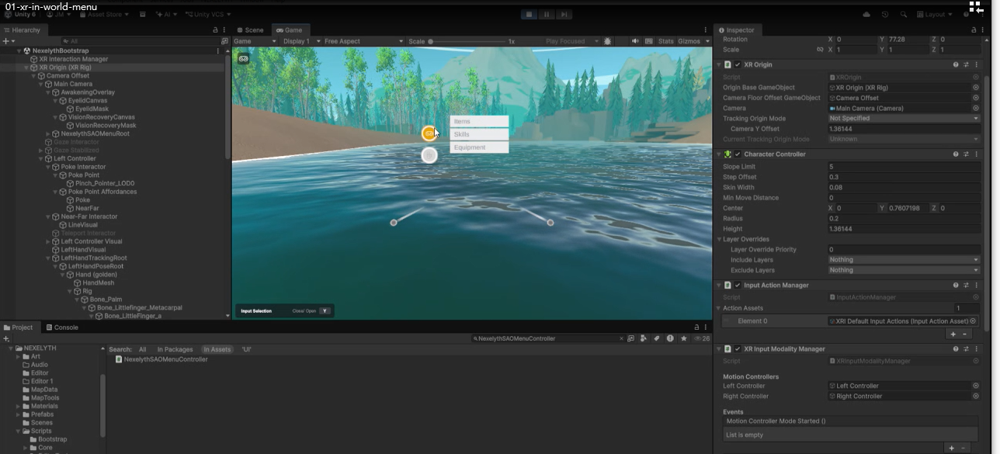

# NEXELYTH

**Unity VR World System Prototype | XR Interaction | Multi-Scene Architecture**

NEXELYTH is a prototype VR world system exploring world travel, persistent player state, immersive XR interactions, and modular gameplay systems across multiple Unity scenes.

The project focuses on designing reusable gameplay architecture, managing XR player state across scenes, and building immersive interfaces and interactions within a virtual world.

## Key Features

- **Portal-Based Teleportation** — Travel between multiple Unity world scenes through interactive portals.
- **Memo Teleportation System** — Record and return to world positions using three independent memory slots.
- **Persistent XR Origin** — Maintain a consistent XR player instance across additive scene loading.
- **Unified Player Location Service** — Manage player location through a single source of truth.
- **XR Player Awakening Sequence** — Implement head-locked eyelid effects, gradual vision recovery, and delayed interaction visibility.
- **XR In-World Menu System** — An SAO-inspired World Space UI featuring menu visibility controls and social interface categories.

## Feature Demonstrations

### 01. XR In-World Menu System

A Sword Art Online-inspired in-world menu prototype developed with Unity 6 and XR Interaction Toolkit.

The interface demonstrates the integration of a World Space Canvas with the XR player environment, providing an in-game menu system designed for immersive VR interaction.

**Technical Highlights**

- World Space Canvas-based user interface.
- Keyboard-triggered menu visibility using the `M` key.
- Integration with XR Origin and the XR player architecture.
- Menu categories for Friends, Party, and Guild.
- Dedicated `NexelythSAOMenuController` for managing menu behaviour.

## Architecture

### World Travel Service (`IWorldTravelService`)

Decouples gameplay features from Unity scene management, allowing teleportation systems to request world transitions through a shared service interface.

### Player Location Service (`NexelythPlayerLocationService`)

Maintains consistent player location data across scenes and provides a unified source of truth for player positioning.

### Scene Management

Uses additive scene loading with a persistent XR Origin to preserve the XR player instance during world transitions.

### Memo System

Stores world positions in three independent runtime slots, allowing players to record and return to previously visited locations.

### Reusable World Locations

Uses ScriptableObject-based location definitions to configure fixed world positions for portals and landmarks.

### Player Awakening Sequence

Coordinates an XR-compatible eyelid shader, progressive vision recovery, and interaction visibility to create a staged first-person awakening experience.

### XR In-World UI

Integrates World Space Canvas interfaces with the XR player environment, separating menu visibility control from the surrounding gameplay scene.

## Technology Stack

| Category | Technology |
|---|---|
| Game Engine | Unity 6 |
| Programming Language | C# |
| Render Pipeline | Universal Render Pipeline (URP) |
| XR Framework | XR Interaction Toolkit |
| Input | Unity Input System |
| UI | Unity Canvas / World Space UI |
| Scene Management | Additive Scene Loading |
| Architecture | Service Interfaces, ScriptableObjects, Persistent XR Player |

## Development Roadmap

The following items are planned extensions and are not presented as completed functionality.

- Transition from **Domain Prototype** to **Persistence / DB Schema** stage.
- Integrate a **C# / ASP.NET Core REST API backend** for world state synchronisation.
- Expand the Memo system with database-backed persistence.
- Implement transaction-safe player state updates using EF Core transactions.
- Continue developing immersive VR player-state transitions and interactions.

## Purpose

This repository is provided for **interview and technical showcase** purposes.

It demonstrates practical experience in:

- C# gameplay programming and Unity XR development.
- Multi-scene architecture and persistent player-state management.
- Service-oriented gameplay system design.
- VR user interfaces and immersive interaction systems.
- Modular system development and extensibility.

Commercial use is strictly prohibited.

## License

Copyright (c) 2026 Nexelyth. All rights reserved.

Unauthorized commercial use is prohibited.
